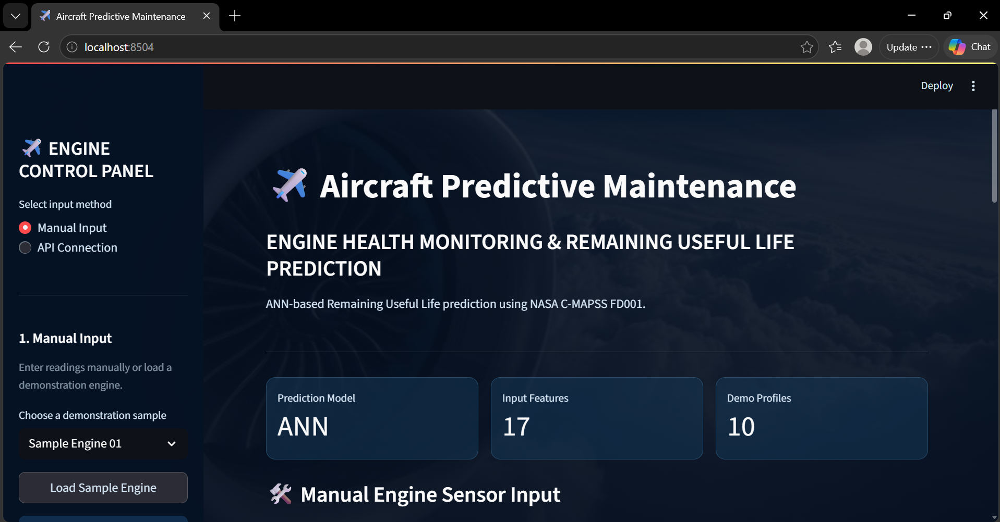
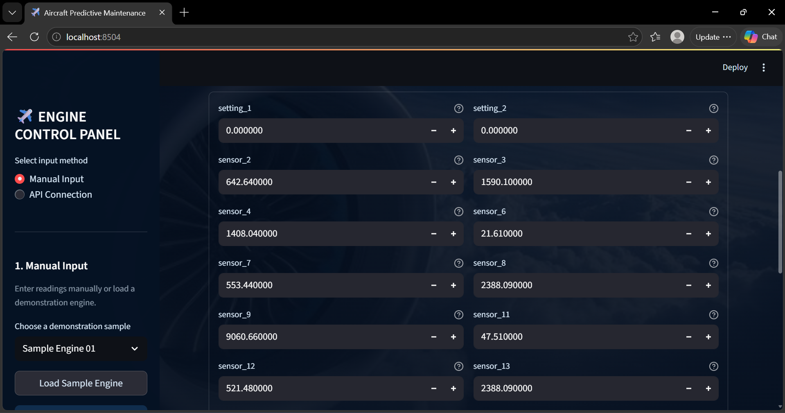
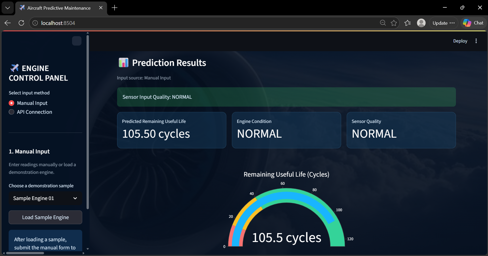
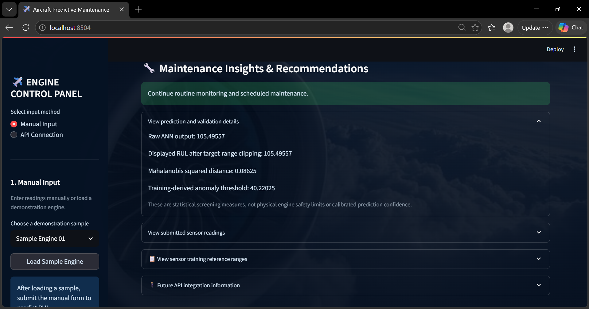

# ✈️ Predictive Maintenance Using Artificial Neural Networks (ANN)

## Project Overview

This project focuses on predicting the Remaining Useful Life (RUL) of aircraft engines using Artificial Neural Networks (ANN).

The NASA C-MAPSS FD001 dataset is used to analyze engine operating conditions and sensor measurements, develop a machine learning model, and estimate the remaining operational cycles of an engine.

An interactive Streamlit application is developed to generate RUL predictions and provide maintenance recommendations based on engine sensor inputs.

## Project Workflow

1. Dataset Collection and Exploration
2. Data Preprocessing
3. RUL Calculation and Target Capping
4. Exploratory Data Analysis
5. Feature Selection
6. Feature Scaling
7. ANN Model Development
8. Model Training and Experimentation
9. Model Evaluation
10. Streamlit Application Development
11. RUL Prediction and Visualization
12. Maintenance Recommendations

## 1. Dataset Collection and Exploration

**Dataset:** NASA C-MAPSS FD001

The dataset contains simulated turbofan engine operational data, including engine identifiers, operational cycles, three operating settings, and 21 sensor measurements.

**Dataset files:**
- `train_FD001.txt`
- `test_FD001.txt`
- `RUL_FD001.txt`

Dataset Source: [NASA Prognostics Center of Excellence](https://www.nasa.gov/intelligent-systems-division/discovery-and-systems-health/pcoe/pcoe-data-set-repository/)

## 2. Data Preprocessing

The following preprocessing activities were performed:

- Loaded and explored the training and testing datasets.
- Assigned appropriate column names.
- Examined data types, statistical summaries and missing values.
- Calculated engine-wise Remaining Useful Life.
- Created the `RUL_capped` target variable.
- Capped RUL values at 125 cycles.
- Prepared the data for model development.

**RUL Calculation:**

`RUL = Maximum Engine Cycle - Current Engine Cycle`

`RUL_capped = min(RUL, 125)`

## 3. Exploratory Data Analysis

Performed exploratory analysis to understand engine degradation and sensor behavior.

Activities included:
- Statistical analysis of sensor measurements.
- Sensor distribution analysis.
- Sensor correlation analysis.
- Identifying sensors with limited variation.
- Studying sensor behavior across engine cycles.
- Understanding relationships between sensor measurements and RUL.

## 4. Feature Selection and Scaling

After analyzing the operating settings and sensor measurements, 17 features were selected for the final ANN model.

**Selected Features:**

```python
[
    'setting_1', 'setting_2',
    'sensor_2', 'sensor_3', 'sensor_4',
    'sensor_6', 'sensor_7', 'sensor_8',
    'sensor_9', 'sensor_11', 'sensor_12',
    'sensor_13', 'sensor_14', 'sensor_15',
    'sensor_17', 'sensor_20', 'sensor_21'
]
```

Feature scaling was performed using a fitted scaler to ensure consistent input transformation during training and prediction.

## 5. ANN Model Development

An Artificial Neural Network regression model was developed to predict the Remaining Useful Life of aircraft engines.

The model development process included:

- Preparing the selected input features.
- Designing the ANN architecture.
- Training the neural network.
- Conducting multiple model experiments.
- Comparing experimental model performance.
- Selecting the final baseline ANN model.
- Saving the trained model.

**Model Input:** 17 selected features.

**Model Output:** Predicted Remaining Useful Life.

## 6. Model Evaluation

The selected baseline ANN model was evaluated using the official test dataset.

| Evaluation Metric | Result |
|---|---:|
| MAE | 11.59 |
| RMSE | 16.85 |
| R² Score | 0.8233 |

Additional evaluation included:
- Actual vs Predicted RUL analysis.
- Prediction error distribution.
- Underprediction and overprediction analysis.
- Residual analysis.

## 7. Model Saving

The trained model and preprocessing artifacts were saved for use in the Streamlit application.

| File | Purpose |
|---|---|
| `ann_baseline.keras` | Trained ANN model |
| `scaler_baseline.pkl` | Feature scaling |
| `feature_columns.pkl` | Selected feature names and order |

The Streamlit application loads these saved artifacts for prediction without retraining the model.

## 8. Streamlit Application Development

An interactive Streamlit application was developed to make the trained ANN model accessible through a user-friendly interface.

**Implemented Features:**

- Aviation-themed dashboard.
- Aircraft background image.
- Manual input for 17 engine features.
- Ten sample engine profiles.
- Sensor input validation.
- Statistical anomaly screening.
- NORMAL, WARNING and CRITICAL classifications.
- ANN-based RUL prediction.
- Interactive RUL gauge using Plotly.
- Maintenance recommendations.
- Training sensor-range reference table.

### Application Dashboard



### Manual Engine Input



### RUL Prediction



### Maintenance Recommendation



## 9. Input Validation and Anomaly Screening

The application checks the entered sensor values using training-data reference ranges and statistical screening.

Three input conditions are implemented:

| Status | Description |
|---|---|
| NORMAL | Values are within observed training ranges. |
| WARNING | Values are outside observed ranges or show unusual combinations. Prediction is allowed. |
| CRITICAL | Values exceed broad statistical screening boundaries. Prediction is blocked. |

Mahalanobis distance is also used for multivariate anomaly screening.

These are statistical screening methods, not certified aircraft sensor safety limits.

## 10. RUL Prediction and Maintenance Recommendations

After successful input validation:

1. The 17 input features are arranged in the correct order.
2. The saved scaler transforms the input.
3. The trained ANN generates an RUL prediction.
4. The prediction is displayed using an interactive gauge.
5. A maintenance recommendation is provided based on the predicted RUL.

**Maintenance Categories:**

| Predicted RUL | Status |
|---|---|
| Above 40 cycles | NORMAL |
| 16–40 cycles | WARNING |
| 0–15 cycles | CRITICAL |

Predictions are limited to the trained target range of 0–125 cycles. Values at the upper cap are displayed as 125+ cycles.

## 11. Technologies Used

- Python
- Pandas
- NumPy
- Scikit-learn
- TensorFlow
- Keras
- Matplotlib
- Seaborn
- Joblib
- Streamlit
- Plotly
- Jupyter Notebook

## 12. Project Structure

```text
predictive_maintanance_project/
│
├── app/
│   ├── app.py
│   └── assets/
│       └── aircraft_background.jpg
│
├── notebooks/
│   ├── 01_data_preprocessing.ipynb
│   └── 02_model_building.ipynb
│
├── models/
│   ├── ann_baseline.keras
│   └── scaler_baseline.pkl
│
├── images/
│   ├── dashboard.png
│   ├── manual_input.png
│   ├── sample_prediction.png
│   └── maintenance_recommendation.png
│
├── requirements.txt
└── README.md
```

## 13. Installation and Execution

**Step 1: Clone the repository**

```bash
git clone https://github.com/your-username/predictive-maintenance.git
```

**Step 2: Navigate to the project directory**

```bash
cd predictive_maintanance_project
```

**Step 3: Install the required libraries**

```bash
pip install -r requirements.txt
```

**Step 4: Run the Streamlit application**

```bash
streamlit run app/app.py
```

## 14. Future Enhancements

- Integration with live industrial sensor data.
- Automatic sensor input through APIs.
- Engine health trend monitoring.
- Improved anomaly detection.
- Exploration of LSTM and GRU architectures.
- Cloud deployment.

## 15. Disclaimer

This project is developed for educational and research purposes using simulated NASA C-MAPSS engine data.

Predictions and maintenance recommendations are not certified aircraft maintenance decisions. The application is not a certified aircraft diagnostic or safety system.

## Author

**Mohammed Aqlath A.**

Predictive Maintenance Using Artificial Neural Networks (ANN)